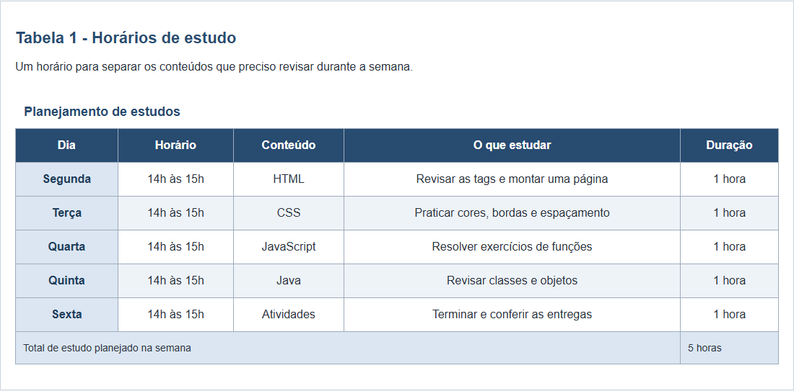
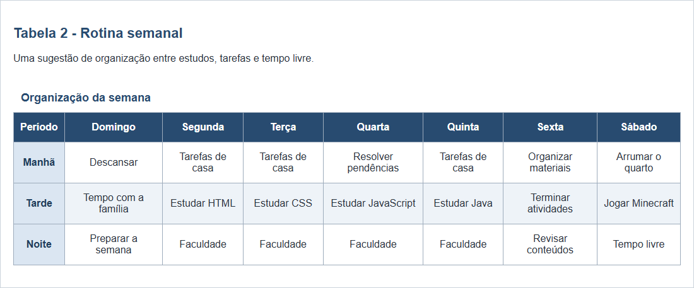

# Atividade 4 - Tabelas

Caio Alves Bezerra

Duas tabelas feitas com HTML e CSS: horários de estudo e rotina semanal.

[Abrir o site](https://caiooalves.github.io/minecraft-primeira-noite/Atividade%204/)

## Prints das tabelas

### Tabela 1

### Tabela 2

